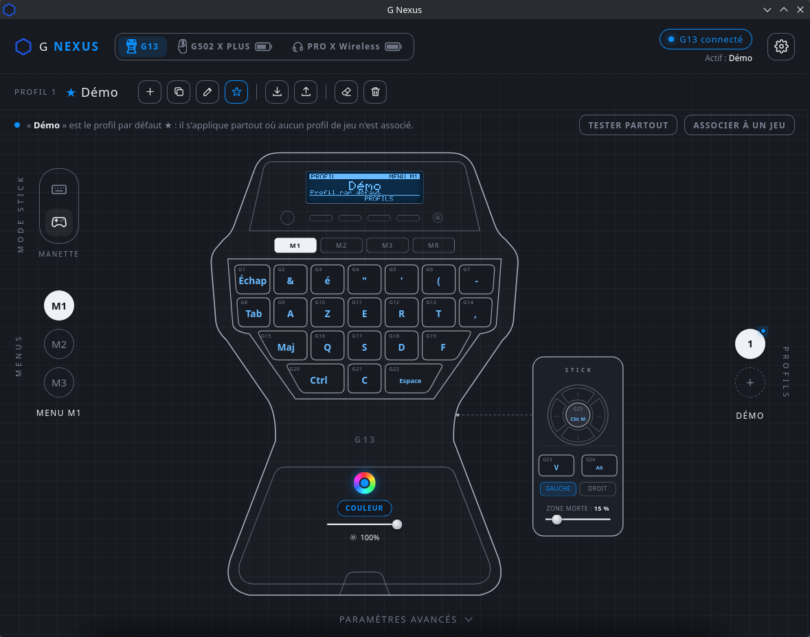
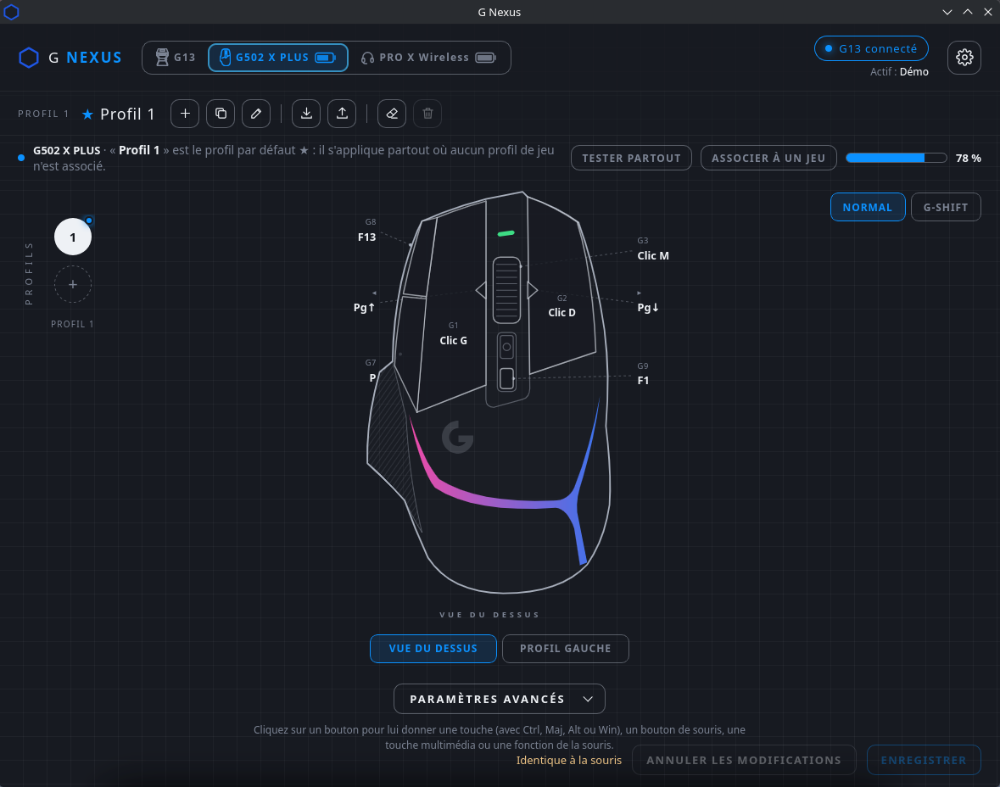
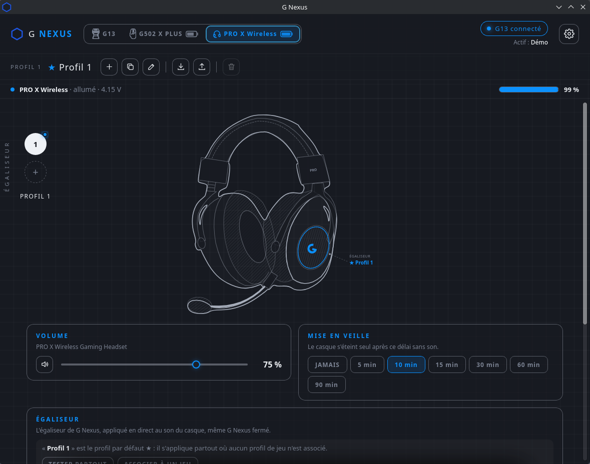
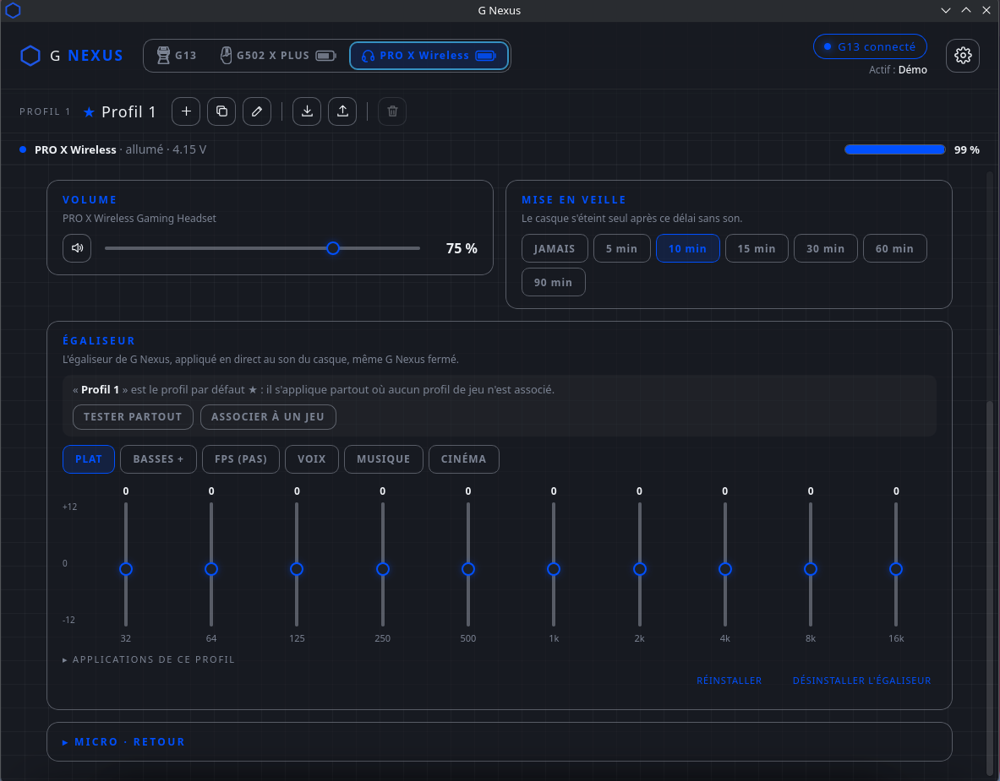
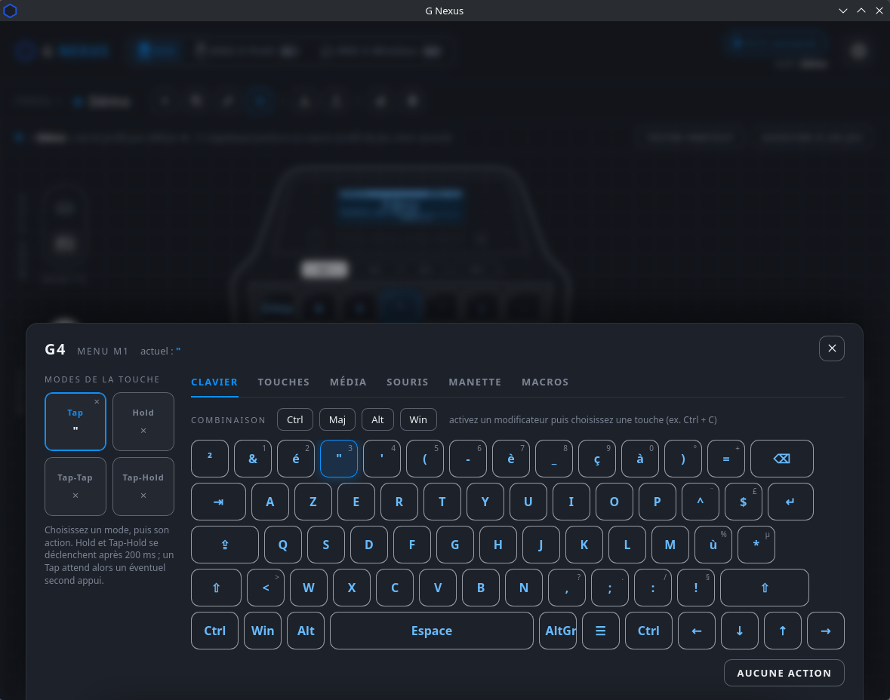
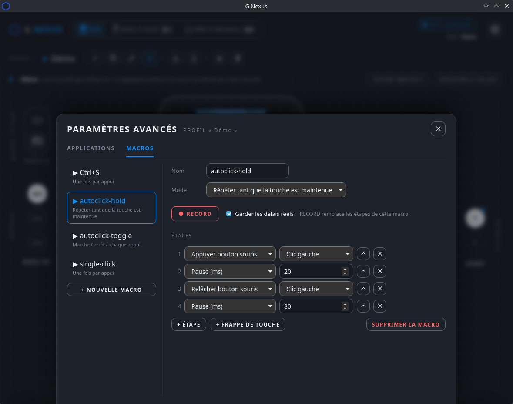
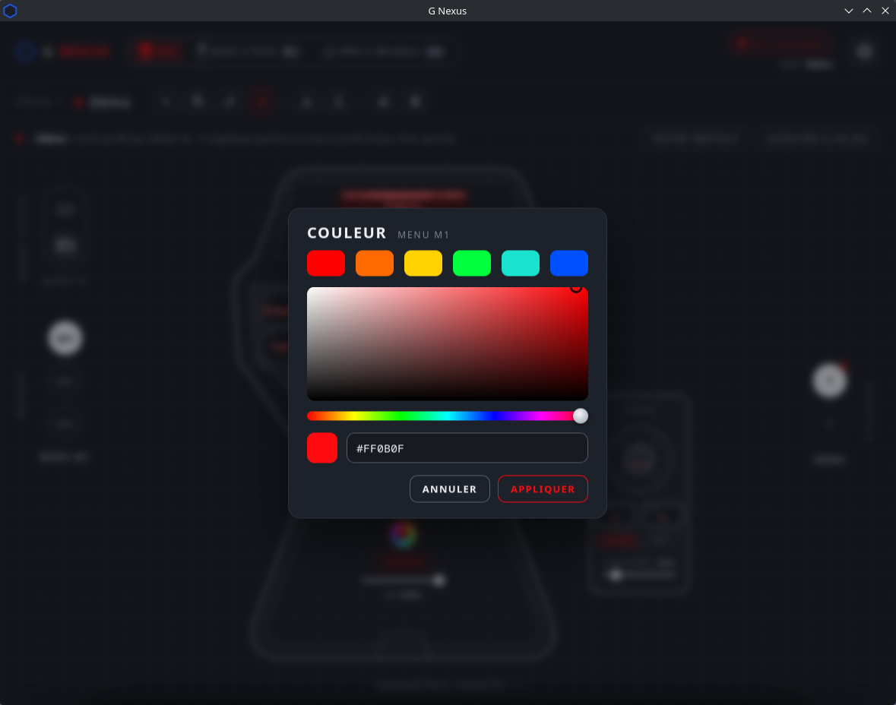
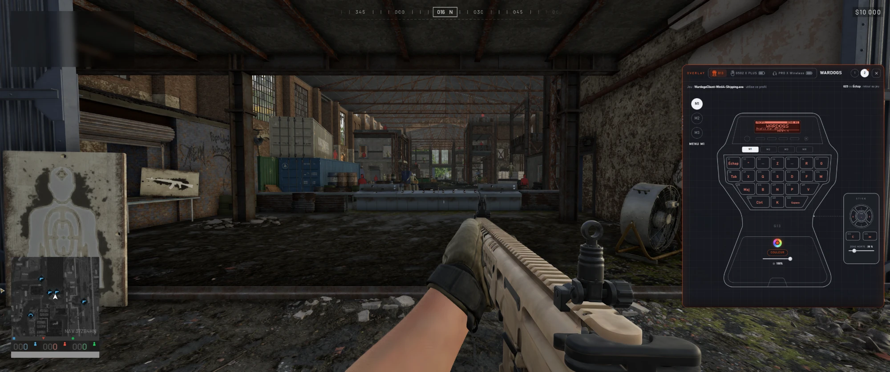

# G Nexus

*[Version française](README.fr.md)*

G Nexus replaces Logitech Gaming Software and G HUB for three Logitech devices, on **Windows** and **Linux**:

- **G13 Advanced Gameboard** (keyboard)
- **G502 X PLUS** mouse (wired or LIGHTSPEED receiver)
- **PRO X Wireless** headset

It runs in the notification area, needs no Logitech software, and keeps working without an internet connection.

## Screenshots

<table>
  <tr>
    <td align="center"> G502 X PLUS: buttons, DPI, lighting</td>
    <td align="center"> PRO X Wireless: battery, volume, sleep</td>
  </tr>
  <tr>
    <td align="center"> 10-band equalizer with per-application profiles</td>
    <td align="center"> Key editor: tap, hold, tap-tap, tap-hold</td>
  </tr>
  <tr>
    <td align="center"> Macros: editor and RECORD</td>
    <td align="center"> Backlight colour per bank</td>
  </tr>
  <tr>
    <td align="center" colspan="2"> In-game overlay: the G13 over the game, on the game's profile (G25 or Esc to go back)</td>
  </tr>
</table>

## Features

**G13**
- Every key remappable: keys and shortcuts, mouse buttons and wheel, macros, multi-state keys (tap / hold / double tap)
- Three banks (M1–M3) with their own backlight colour, profiles per application (switched automatically with the game in the foreground)
- Macros: editor, library, recording with the RECORD (MR) key
- Stick as four keys, or as the analog stick of a virtual Xbox 360 controller
- LCD screen applets: clock, system monitor, now playing (media controls), profile picker
- In-game overlay to edit keys without leaving the game
- Import / export of Logitech Gaming Software profiles (`.xml`)

**G502 X PLUS**
- DPI levels, report rate, lighting
- Onboard profiles stored in the mouse, or real-time mode with one profile per game
- Button remapping and mouse macros

**PRO X Wireless**
- Battery, sidetone, automatic sleep, volume
- G Nexus's own 10-band equalizer, with profiles per application

**And also**: automatic backups, export / import of the whole configuration (`.g13backup`), interface in French, English, German, Italian and Spanish.

## Download

Installers are attached to each [release](../../releases): Windows installer and Arch / CachyOS package.

### Windows

1. Run the installer (`G Nexus_x.y.z_x64-setup.exe`). WebView2 is required (included in Windows 11).
2. Close Logitech Gaming Software: it captures the G13's keys. Keep G HUB closed while G Nexus drives the mouse or the headset.
3. Optional: the [ViGEmBus](https://github.com/nefarius/ViGEmBus) driver for the stick's gamepad mode.
4. The equalizer is installed from the Headset page (Windows asks for administrator rights once).

### Linux

Tested on CachyOS (Arch), KDE Plasma 6, Wayland, PipeWire. Automatic profile switching and the in-game overlay need **KDE Plasma**; everything else works on any desktop.

1. Arch / CachyOS: install the package attached to the release, `sudo pacman -U gnexus-x.y.z-1-x86_64.pkg.tar.zst` (or build it with the [`PKGBUILD`](deploy/linux/arch)). It installs the udev rules and loads `uinput`; plug the devices in again afterwards. Other distributions: build from source (see below).
2. Device access without root comes from the udev rules in [`deploy/linux`](deploy/linux) (installed by the package). The optional `71-gnexus-record.rules` rule is only needed to record macros: the package prints how to enable it.
3. Do not run another program driving the same devices at the same time (Solaar, Piper / libratbag, HeadsetControl).
4. The equalizer is a PipeWire filter placed in front of the headset's output: no root rights, and the default output does not change.

Your Windows configuration can be moved over: *Settings › Configuration › Export* on Windows, then *Import* on Linux.

## Building from source

Rust (stable) is required. The workspace is `cargo test --workspace`, `cargo clippy --workspace --all-targets`.

- **Linux** (Arch packages): `webkit2gtk-4.1 gtk3 libayatana-appindicator hidapi systemd-libs base-devel`, then
  `CARGO_TARGET_DIR=target cargo build --release -p g13-gui` (binary `target/release/g13-studio`).
  `.cargo/config.toml` holds a build directory specific to the author's Windows machine: `CARGO_TARGET_DIR` overrides it.
- **Windows** (GNU toolchain): from `crates/g13-gui`, `npx @tauri-apps/cli@2 build` builds the NSIS installer.

Technical documentation (in French): [`docs/ARCHITECTURE.md`](docs/ARCHITECTURE.md), [`docs/LINUX_PORT.md`](docs/LINUX_PORT.md).

## Credits

Design inspired by the YouTube channel [JaspMakes](https://www.youtube.com/watch?v=315USgAl2Ks).

## Disclaimer

G Nexus is not affiliated with Logitech. Logitech, G13, G502 and PRO X are trademarks of Logitech.
It talks to the devices with their own protocols (HID, HID++ 2.0); use it at your own risk.

## License

Licensed under either of [Apache License 2.0](LICENSE-APACHE) or [MIT license](LICENSE-MIT), at your option.
